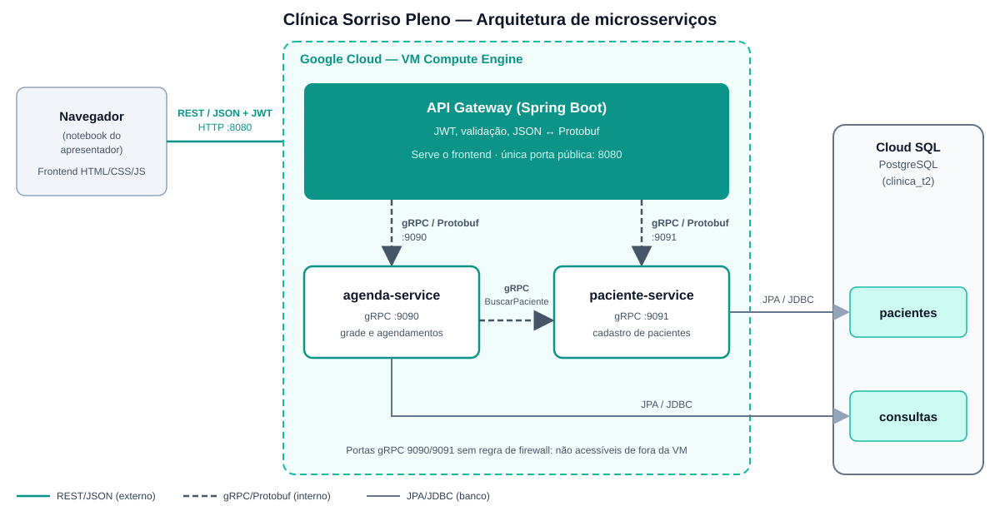
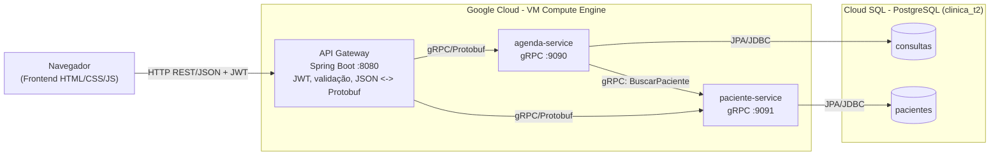
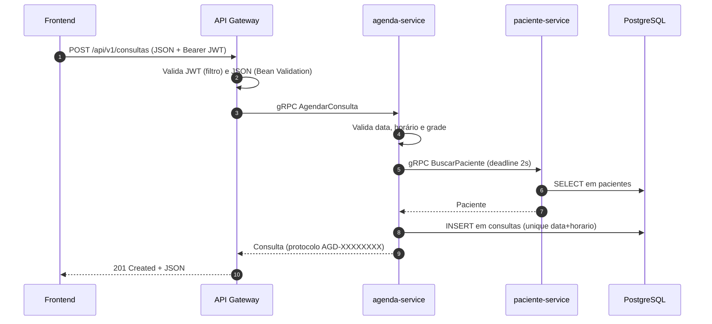

# Clínica Sorriso Pleno — Agendamento com microsserviços gRPC (Trabalho 2)

Sistema de agendamento de consultas de uma clínica odontológica, construído para a disciplina de Sistemas Distribuídos.

**Fluxo geral:** Frontend (HTML/CSS/JS) → **API Gateway** (REST/JSON + JWT) → **2 microsserviços gRPC** (paciente e agenda) → **PostgreSQL**.



## Sumário

1. [Arquitetura](#arquitetura)
2. [Contratos gRPC](#contratos-grpc)
3. [API REST](#api-rest)
4. [Banco de dados](#banco-de-dados)
5. [Requisitos e build](#requisitos-e-build)
6. [Execução local](#execução-local)
7. [Implantação no Google Cloud](#implantação-no-google-cloud)
8. [Roteiro de demonstração (10 min)](#roteiro-de-demonstração-10-min)
9. [Estrutura do repositório](#estrutura-do-repositório)

---

## Arquitetura



### Componentes

| Componente | Porta | Responsabilidade |
|---|---|---|
| `frontend/` | servido pelo Gateway | HTML/CSS/JS puros; fala **somente** com o Gateway (`/api/v1`) |
| `api-gateway` | HTTP **8080** (única porta pública) | Serve o frontend, autentica (JWT), valida JSON, traduz JSON ↔ Protobuf, chama os serviços gRPC e converte status gRPC em HTTP |
| `agenda-service` | gRPC **9090** (interna) | Grade de horários, agendamento e listagem de consultas (tabela `consultas`). Chama `PacienteService.BuscarPaciente` ao agendar |
| `paciente-service` | gRPC **9091** (interna) | Cadastro e consulta de pacientes (tabela `pacientes`) |
| `contratos-grpc` | — | `agenda.proto` e `paciente.proto` (classes Java geradas, compartilhadas) |
| PostgreSQL | 5432 | Banco `clinica_t2` (Cloud SQL em produção) |

### Por que REST na borda e gRPC por dentro?

- **REST/JSON na borda:** é o que o navegador entende nativamente (`fetch`), é fácil de testar com `curl` e é o padrão para clientes externos.
- **gRPC/Protobuf por dentro:** contrato fortemente tipado (`.proto`), serialização binária compacta, *deadlines* por chamada e status de erro padronizados. Entre serviços internos, esses ganhos compensam, e as portas gRPC nunca são expostas à internet.
- O **Gateway** é o único ponto de contato: concentra autenticação, validação e tradução de formatos, de modo que o frontend nunca fala diretamente com gRPC.

### Fluxo de agendamento



---

## Contratos gRPC

**`PacienteService`** (`paciente.proto`, porta 9091)

| RPC | Requisição → Resposta | Erros gRPC |
|---|---|---|
| `CadastrarPaciente` | `CadastrarPacienteRequest` → `Paciente` | `INVALID_ARGUMENT`, `ALREADY_EXISTS` (CPF duplicado) |
| `BuscarPaciente` | `BuscarPacienteRequest` → `Paciente` | `NOT_FOUND` |
| `ListarPacientes` | `ListarPacientesRequest` → `ListarPacientesResponse` | — |

**`AgendaService`** (`agenda.proto`, porta 9090)

| RPC | Requisição → Resposta | Erros gRPC |
|---|---|---|
| `ConsultarDisponibilidade` | `ConsultarDisponibilidadeRequest` → `ConsultarDisponibilidadeResponse` | `INVALID_ARGUMENT` |
| `AgendarConsulta` | `AgendarConsultaRequest` → `Consulta` | `INVALID_ARGUMENT`, `NOT_FOUND` (paciente), `ALREADY_EXISTS` (horário), `UNAVAILABLE`, `DEADLINE_EXCEEDED` |
| `ListarConsultas` | `ListarConsultasRequest` → `ListarConsultasResponse` | — |

Todas as chamadas gRPC têm *deadline* (Gateway: 5s; agenda → paciente: 2s).

## API REST

Prefixo `/api/v1`. Todas as rotas exigem `Authorization: Bearer <token>`, exceto `POST /auth/login` e os arquivos estáticos do frontend. Corpo de erro sempre `{"message": "texto em português"}`.

| Método e rota | Corpo / parâmetros | Sucesso | Erros |
|---|---|---|---|
| `POST /auth/login` | `{"usuario","senha"}` | 200 `{"accessToken","tokenType":"Bearer","expiresIn":3600}` | 400 campos ausentes, 401 credencial errada |
| `GET /pacientes` | — | 200 `[Paciente]` | 401 |
| `GET /pacientes/{id}` | — | 200 `Paciente` | 401, 404 |
| `POST /pacientes` | `{"nome","cpf","telefone","email"}` | 201 `Paciente` + header `Location` | 400, 401, 409 CPF duplicado |
| `GET /agenda/disponibilidade?data=yyyy-MM-dd` | `data` obrigatório | 200 `{"data","horariosLivres":[...]}` | 400, 401 |
| `GET /consultas?data=yyyy-MM-dd` | `data` opcional | 200 `[Consulta]` | 400, 401 |
| `POST /consultas` | `{"pacienteId","procedimento","data","horario"}` | 201 `Consulta` | 400, 401, 404 paciente, 409 horário ocupado |

`procedimento` aceita `LIMPEZA`, `RESTAURACAO`, `CANAL`, `EXTRACAO`, `CLAREAMENTO`. Grade de horários: `09:00, 10:00, 11:00, 14:00, 15:00, 16:00, 17:00`, de segunda a sábado.

### Mapeamento gRPC → HTTP

Feito no Gateway por um `@RestControllerAdvice`:

| Status gRPC | HTTP |
|---|---|
| `INVALID_ARGUMENT` | 400 |
| `NOT_FOUND` | 404 |
| `ALREADY_EXISTS` | 409 |
| `UNAVAILABLE` | 503 |
| `DEADLINE_EXCEEDED` | 504 |
| demais | 500 |

**Quem gera o 401?** O filtro do Spring Security (resource server JWT), **antes** de a requisição chegar ao controller. Sem token, token inválido ou expirado → 401 sem nunca tocar nos microsserviços.

---

## Banco de dados

- Um único PostgreSQL, database **`clinica_t2`**, com duas tabelas: `pacientes` e `consultas`.
- Cada serviço acessa **apenas a sua tabela** (`paciente-service` → `pacientes`, `agenda-service` → `consultas`). Não há chave estrangeira entre elas: a ligação é feita via gRPC (`BuscarPaciente`), e a consulta guarda uma cópia de `paciente_nome`.
- As tabelas são criadas automaticamente pelo JPA/Hibernate (`spring.jpa.hibernate.ddl-auto=update`).
- Restrição única `(data, horario)` em `consultas`: impede dois agendamentos no mesmo horário, mesmo em chamadas concorrentes. O CPF também é único em `pacientes`.

## Requisitos e build

- **JDK 21** (o Maven Wrapper `mvnw` já está incluso; não é preciso instalar Maven).
- Um PostgreSQL acessível.

```bash
./mvnw clean package -DskipTests
```

Gera os jars:

- `paciente-service/target/paciente-service-2.0.0-SNAPSHOT.jar`
- `agenda-service/target/agenda-service-2.0.0-SNAPSHOT.jar`
- `api-gateway/target/api-gateway-2.0.0-SNAPSHOT.jar`

## Execução local

### Variáveis de ambiente

| Variável | Quem usa | Padrão (desenvolvimento) |
|---|---|---|
| `DB_URL` | paciente, agenda | `jdbc:postgresql://localhost:5432/clinica_t2` |
| `DB_USER` | paciente, agenda | `postgres` |
| `DB_PASSWORD` | paciente, agenda | vazio |
| `GRPC_PORT` | paciente (9091), agenda (9090) | 9091 / 9090 |
| `PACIENTE_GRPC_TARGET` | agenda, gateway | `static://localhost:9091` |
| `AGENDA_GRPC_TARGET` | gateway | `static://localhost:9090` |
| `GRPC_DEADLINE` | gateway | `5s` |
| `SERVER_PORT` | gateway | `8080` |
| `APP_USERNAME` / `APP_PASSWORD` | gateway | `admin` / `admin` |
| `JWT_SECRET` | gateway | segredo didático (32+ bytes) |
| `JWT_EXPIRATION_SECONDS` | gateway | `3600` |

### Três terminais

Crie antes o database: `CREATE DATABASE clinica_t2;`

```bash
# Terminal 1 - paciente-service (gRPC 9091)
export DB_URL=jdbc:postgresql://localhost:5432/clinica_t2 DB_USER=postgres DB_PASSWORD=sua_senha
java -jar paciente-service/target/paciente-service-2.0.0-SNAPSHOT.jar

# Terminal 2 - agenda-service (gRPC 9090)
export DB_URL=jdbc:postgresql://localhost:5432/clinica_t2 DB_USER=postgres DB_PASSWORD=sua_senha
java -jar agenda-service/target/agenda-service-2.0.0-SNAPSHOT.jar

# Terminal 3 - api-gateway (HTTP 8080)
java -jar api-gateway/target/api-gateway-2.0.0-SNAPSHOT.jar
```

Acesse <http://localhost:8080> (login padrão `admin` / `admin`).

---

## Implantação no Google Cloud

Topologia: **uma VM Compute Engine** (Linux, ex.: Debian/Ubuntu) executa o Gateway e os dois microsserviços; o **PostgreSQL fica no Cloud SQL**.

### 1. Criar o database no Cloud SQL

A instância já existe. No console: **SQL → sua instância → Bancos de dados → Criar banco de dados** → nome `clinica_t2`. Anote também o **endereço IP público** da instância (aba Visão geral) e o usuário/senha (aba Usuários).

### 2. VM e IP externo

Use a VM que já existe (ou crie uma Debian/Ubuntu em Compute Engine → Instâncias de VM; e2-small ou maior serve). Anote o **IP externo** da VM. A regra de firewall necessária está no passo 7.

### 3. Autorizar a VM no Cloud SQL

Cloud SQL → instância → **Conexões → Rede → Redes autorizadas → Adicionar rede**: informe `IP_EXTERNO_DA_VM/32` e salve. Sem isso, a conexão com o banco é recusada.

### 4. Preparar a VM

Conecte por SSH (botão **SSH** no console) e execute:

```bash
sudo apt update
sudo apt install -y openjdk-21-jdk git postgresql-client
java -version   # deve mostrar 21

git clone https://github.com/dan-jesus/clinica-agendamento-grpc.git clinica && cd clinica
./mvnw clean package -DskipTests
```

> Se `openjdk-21-jdk` não existir no repositório da distribuição, use Ubuntu 24.04 / Debian 13, ou instale o Temurin 21.

### 5. Configurar as variáveis (fora do repositório)

Nunca coloque senha no código nem no Git. Crie um arquivo na home, fora do repo:

```bash
cat > ~/clinica.env <<'EOF'
DB_URL=jdbc:postgresql://IP_PUBLICO_CLOUD_SQL:5432/clinica_t2?sslmode=require
DB_USER=postgres
DB_PASSWORD=SENHA_DO_BANCO
APP_PASSWORD=senha_forte_do_app
JWT_SECRET=troque-por-um-segredo-aleatorio-com-mais-de-32-bytes
EOF
chmod 600 ~/clinica.env
```

Carregue no shell antes de subir os processos:

```bash
set -a; source ~/clinica.env; set +a
```

Em produção, **troque `JWT_SECRET` e `APP_PASSWORD`** (os padrões são didáticos e públicos).

### 6. Subir os três serviços

Ainda em `~/clinica` e com as variáveis carregadas:

```bash
mkdir -p ~/logs
nohup java -jar paciente-service/target/paciente-service-2.0.0-SNAPSHOT.jar > ~/logs/paciente.log 2>&1 &
nohup java -jar agenda-service/target/agenda-service-2.0.0-SNAPSHOT.jar     > ~/logs/agenda.log 2>&1 &
sleep 15
nohup java -jar api-gateway/target/api-gateway-2.0.0-SNAPSHOT.jar           > ~/logs/gateway.log 2>&1 &
```

Na primeira execução o Hibernate cria as tabelas `pacientes` e `consultas` automaticamente.

### 7. Firewall da VPC: somente a porta 8080

VPC network → **Firewall → Criar regra**:

- Direção: entrada; ação: permitir
- Destinos: tag de rede da VM (adicione a tag, ex. `clinica`, à VM) ou todas as instâncias
- Origem: `0.0.0.0/0` (ou o IP do seu notebook, mais seguro)
- Protocolos e portas: **tcp:8080**

**Não crie regra para as portas 9090 e 9091.** Os serviços gRPC se comunicam por `localhost` dentro da VM e ficam inacessíveis de fora. Isso garante, por construção de rede, que o frontend nunca fala diretamente com gRPC: o único caminho de entrada é o Gateway.

### 8. Acessar

No navegador do notebook: `http://IP_EXTERNO_DA_VM:8080`

### Operação

```bash
# Ver logs (acompanhar em tempo real)
tail -f ~/logs/gateway.log
tail -f ~/logs/agenda.log
tail -f ~/logs/paciente.log

# Ver processos
pgrep -af "clinica|-SNAPSHOT.jar"

# Parar tudo
pkill -f paciente-service
pkill -f agenda-service
pkill -f api-gateway

# Reiniciar: recarregue o env e repita o passo 6
set -a; source ~/clinica.env; set +a
```

### Se falhar a conexão com o banco

O Spring mostra o erro de conexão no log do serviço (`~/logs/paciente.log` ou `~/logs/agenda.log`, algo como `Connection ... refused/timed out` ou `password authentication failed`). Verifique:

1. O IP externo da VM está em **Redes autorizadas** do Cloud SQL (com `/32`)? Se a VM foi recriada, o IP pode ter mudado.
2. `DB_URL` usa o **IP público do Cloud SQL** e o database `clinica_t2` existe?
3. Usuário e senha corretos? Teste direto da VM:

```bash
set -a; source ~/clinica.env; set +a
PGPASSWORD="$DB_PASSWORD" psql -h IP_PUBLICO_CLOUD_SQL -U "$DB_USER" -d clinica_t2 -c "SELECT 1;"
```

4. Confirme que `set -a; source ~/clinica.env; set +a` foi executado **no mesmo shell** que iniciou os jars.

---

## Roteiro de demonstração (10 min)

Substitua `IP` pelo IP externo da VM. No terminal do notebook ou na própria VM.

| Tempo | O que mostrar | Resultado esperado |
|---|---|---|
| 0:00 – 1:30 | Slide/imagem da arquitetura (`docs/arquitetura.svg`) e console do Google Cloud: VM, Cloud SQL, regra de firewall só com tcp:8080 | Explicar REST na borda, gRPC interno, portas 9090/9091 fechadas |
| 1:30 – 2:30 | Abrir `http://IP:8080` e fazer **login** | Entra no sistema (JWT guardado no navegador) |
| 2:30 – 4:00 | **Cadastrar paciente** com dados válidos | **201 Created**, paciente listado |
| 4:00 – 5:30 | **Agendar consulta** para esse paciente (data futura, dia útil) | **201 Created** e exibição do **protocolo** `AGD-XXXXXXXX` |
| 5:30 – 6:15 | Repetir o agendamento no **mesmo dia e horário** | **409** "horário já ocupado" |
| 6:15 – 7:15 | **400**: enviar formulário inválido (CPF com menos de 11 dígitos) ou usar o curl abaixo | **400** com mensagem em português |
| 7:15 – 8:00 | **401**: `curl` sem token | **401** barrado no filtro, antes do controller |
| 8:00 – 9:30 | **Persistência**: consultar o banco (Cloud SQL Studio ou psql) | Linhas em `pacientes` e `consultas` |
| 9:30 – 10:00 | Mostrar os logs do Gateway/serviços e encerrar | Requisições logadas (método, rota, status) |

### Comandos prontos

```bash
IP=IP_EXTERNO_DA_VM

# Login: pega o token (usuário/senha configurados em APP_USERNAME/APP_PASSWORD)
TOKEN=$(curl -s -X POST http://$IP:8080/api/v1/auth/login \
  -H "Content-Type: application/json" \
  -d '{"usuario":"admin","senha":"SUA_SENHA"}' | sed -E 's/.*"accessToken":"([^"]+)".*/\1/')
echo $TOKEN

# 401 - sem token
curl -i http://$IP:8080/api/v1/pacientes

# 200 - com token
curl -i http://$IP:8080/api/v1/pacientes -H "Authorization: Bearer $TOKEN"

# 400 - cadastro inválido (CPF curto, nome vazio)
curl -i -X POST http://$IP:8080/api/v1/pacientes \
  -H "Authorization: Bearer $TOKEN" -H "Content-Type: application/json" \
  -d '{"nome":"","cpf":"123","telefone":"62999998888"}'

# 201 - cadastro válido
curl -i -X POST http://$IP:8080/api/v1/pacientes \
  -H "Authorization: Bearer $TOKEN" -H "Content-Type: application/json" \
  -d '{"nome":"Ana Souza","cpf":"12345678901","telefone":"62999998888","email":"ana@email.com"}'

# 201 e depois 409 (repetir o mesmo comando) - agendamento (ajuste a data para um dia útil futuro)
curl -i -X POST http://$IP:8080/api/v1/consultas \
  -H "Authorization: Bearer $TOKEN" -H "Content-Type: application/json" \
  -d '{"pacienteId":1,"procedimento":"LIMPEZA","data":"2026-12-10","horario":"10:00"}'
```

### Persistência no banco

No console: **SQL → instância → Cloud SQL Studio** (autentique com usuário e senha, database `clinica_t2`), ou via `psql` na VM:

```sql
SELECT * FROM pacientes;
SELECT * FROM consultas;
```

Comprove que os registros criados na demonstração (inclusive o protocolo) estão gravados.

---

## Estrutura do repositório

```
.
├── pom.xml                  # POM pai (módulos, versões)
├── mvnw / mvnw.cmd          # Maven Wrapper
├── contratos-grpc/          # agenda.proto e paciente.proto
│   └── src/main/proto/
├── paciente-service/        # gRPC :9091, JPA (tabela pacientes)
│   └── src/main/java/clinica/paciente/
├── agenda-service/          # gRPC :9090, JPA (tabela consultas), cliente do paciente-service
│   └── src/main/java/clinica/agenda/
├── api-gateway/             # REST :8080, JWT, validação, mapeamento gRPC -> HTTP
│   └── src/main/java/clinica/gateway/{config,controller,dto,error,mapper}
├── frontend/                # index.html, app.js, styles.css (servidos pelo Gateway)
└── docs/
    ├── especificacao.md     # especificação técnica
    └── arquitetura.svg      # diagrama de arquitetura
```
